# 短视频工具 用户操作手册

> 适用版本：ShortVideoTool **1.0.5**（Windows NSIS 安装包）
> 适用读者：本地运营人员（单人 / 团队），需要批量管理视频平台账号、选品、素材、发布

---

## 一、产品概述

短视频工具是一款**本地化**的个人 / 小团队短视频运营工作台，覆盖「**账号 → 选品 → 素材 → 创作 → 发布 → 数据**」全流程。

**核心特点**：

- **数据本地化**：所有账号登录态、素材、成品视频、数据库都存在你本机的「数据目录」，不依赖任何云端服务。
- **多账号管理**：支持同时管理多个视频平台账号，每个账号独立 Cookie 持久化、定时登录态检测。
- **批量 + 模板化**：发布向导 6 步支持「项目模式」与「视频目录模式」，一次配置可批量产出多个发布任务。
- **风险可控**：账号登录态失效 / 发布任务异常都会在「工作台 → 待处理事项」集中呈现，不会静默失败。
- **自动更新**：新版本发布后，程序自动在后台下载，关掉程序即完成安装，无需手动下载安装包。

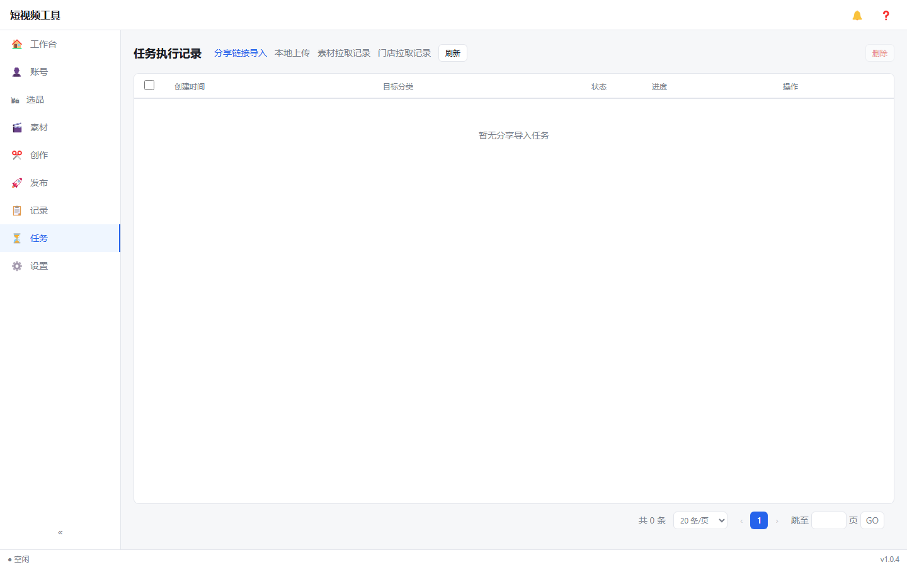

---

## 二、安装与首次启动

### 2.1 安装

1. 双击 `ShortVideoTool Setup 1.0.5.exe`（NSIS 安装包），选择安装目录（**默认 `C:\Users\<用户>\AppData\Local\Programs\ShortVideoTool\`**，可改）。
2. 安装过程会解压后端单 exe（`shortvideo-backend.exe`）到 `resources/backend/`，与前端共用同一目录。
3. 安装完成后，桌面会出现 `短视频工具` 快捷方式。

> ⚠️ 安装目录可在安装向导中修改，但**不建议**装到 `C:\Program Files\`（无写权限会导致日志/缓存写入失败）。

> 💡 **覆盖安装是安全的**：重新安装新版本时，原有的数据目录（账号登录态、素材、成品、数据库）会完整保留。

### 2.2 卸载

- 标准卸载流程会**自动删除**程序在 `%APPDATA%` 下的缓存文件，避免残留导致下次安装报权限错误。
- **你的数据目录不会被卸载删除**，账号登录态 / 素材 / 成品 / 数据库都还在。重装后重新指定同一数据目录即可继续使用。

### 2.3 首次启动 — 选择数据目录

首次启动会弹「**选择数据目录**」对话框：

| 按钮 | 行为 |
|---|---|
| 使用默认（空间最大盘根下的 `ShortVideoToolData\`） | 自动选择空间最大的本地磁盘 |
| 立即选择... | 弹出系统目录选择器，自定义路径 |
| 取消 | 重新选择 / 退出（最多重试 5 次） |

**数据目录用于存储**：

- `db\` SQLite 数据库（含账号 / 选品 / 素材 / 创作 / 发布 / 通知 26 张表）
- `material\` `create\` `finished\` 视频文件（按 ID 分目录）
- `accounts\<id>\profile\` Chromium 持久化登录态
- `temp\` `cache\` `log\` 临时与日志文件

> 💡 **建议**：选空间大的非系统盘（如 H 盘、D 盘），避免 C 盘占满。默认目录名是 `ShortVideoToolData`（不是 `ShortVideoData`）。

### 2.4 风险告知

首次进入主界面会弹出「**风险告知**」窗口，本工具依赖目标视频平台 Web 接口（非官方开放能力），自动化行为**可能影响账号权重**。请合理控制使用频率。

---

## 三、主界面导航

顶部导航栏从左到右：

| 页面 | 主要用途 | 何时使用 |
|---|---|---|
| **工作台** | 指标总览 + 待处理事项 | 每次打开程序先看一眼 |
| **账号** | 多账号管理 / 登录 / 启停 | 添加新账号 / 失效重登 |
| **选品** | 选品广场门店筛选 / 标记 | 找新门店、筛选佣金率 |
| **素材** | 树形分类 / 视频拉取 / 上传 | 拉视频、整理素材库 |
| **创作** | 项目 + 分镜 / 切割组合 / 去重 | 批量生成成品视频 |
| **发布** | 6 步向导 / 任务队列 | 批量发布、查看进度 |
| **记录** | 发布历史 / Excel 导出 / 失败重试 | 复盘、导出对账 |
| **任务** | 后台任务队列（运行中 / 已完成） | 排查卡住的任务 |
| **设置** | 数据目录 / 备份 / 清理 / 通知 | 配置 + 维护 |

> 💡 **Ctrl + F12**：随时打开「开发者工具」排查 UI 问题（生产环境也生效）。

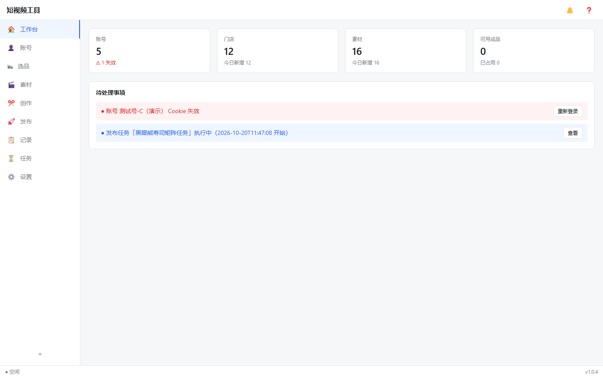

---

## 四、工作台

打开程序默认进入。**两类信息**：

### 4.1 指标卡（4 张）

| 指标 | 含义 | 点击跳转 |
|---|---|---|
| 账号 | 总账号数（⚠️ 失效数会标红） | 账号页 |
| 门店 | 已选门店总数 + 今日新增 | 选品页 |
| 素材 | 素材总数 + 今日新增 | 素材页 |
| 可用成品 | 未占用的成品视频数 + 已占用数 | 创作页 |

### 4.2 待处理事项

| 类型 | 触发场景 | 处理方式 |
|---|---|---|
| 🔴 账号 Cookie 失效 | 登录态过期（密码修改 / 异地登录 / 平台风控） | 点「**重新登录**」走 ReloginDialog 粘贴新 Cookie |
| 🔵 发布任务执行中 | 任务在跑 | 点「**查看**」跳到发布页 |

---

## 五、账号管理

### 5.1 添加账号

两种方式：

1. **扫码登录**（推荐）：点击「**添加账号**」→ 弹出内置浏览器 → 用目标平台 App 扫码 → 自动保存登录态。
2. **粘贴 Cookie**：在「ReloginDialog」粘贴从浏览器 DevTools 复制的 Cookie 字符串 → 自动同步到本地 Chromium profile。

### 5.2 账号列表

每个账号卡片展示：

- 平台昵称 / 备注
- 登录状态（🟢 正常 / 🔴 失效 / 🟡 检测中）
- 启停按钮（停用后不参与定时拉取）
- 上次检测时间

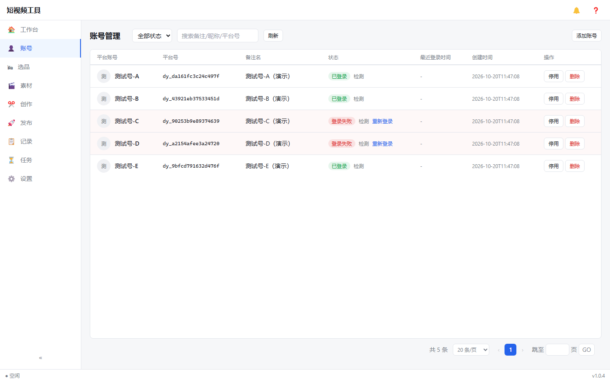

### 5.3 失效账号处理

程序会周期性检测各账号的登录态。**同一账号在 30 分钟内不会重复发起检测**（冷却机制，避免频繁请求触发平台风控）。**失效账号不会自动重登**（同样是为了避免风控），需要手动：

1. 工作台 → 点「**重新登录**」
2. 选择「粘贴 Cookie」（最快）或「扫码」
3. 完成 → 自动恢复状态

> ⚠️ **不要短时间内高频重新登录**：可能触发平台风控导致二次失效。

> 💡 **素材拉取也依赖登录态**：账号失效时素材拉取任务同样会失败，重新登录后即可恢复，无需重新配置拉取任务。

---

## 六、选品中心

### 6.1 拉取任务

选品页可创建「**定时拉取任务**」：

- 设定拉取时间（每天 / 每周 / 自定义 cron）
- 设定筛选条件：佣金率 / 类目 / 达人数 / 销量 / 核销率 / 销售额
- **排序依据**（3 选 1，默认「最新发布」）：

| 选项 | 含义 |
|---|---|
| 综合排序 | 按平台综合推荐排序 |
| 最多点赞 | 按点赞数从高到低 |
| 最新发布 | 按发布时间从新到旧 |

- 启动任务后会在后台按计划拉取，门店自动入库

> 💡 拉取任务支持**多选账号 / 多选类目**，可在任务列表随时暂停 / 恢复 / 编辑。切换 Tab 不会重复触发请求，列表右上角有「**手动刷新**」按钮。

### 6.2 门店库

- **筛选**：左侧条件面板（佣金 / 类目 / 时间）
- **标记**：选中门店后右键 →「**标记 / 取消标记**」（已标记的门店才能在发布向导挂载）
- **累计发布次数**：门店卡片上会显示「已发布 N 次」，鼠标悬停看全称。这个数字在每次**发布成功**后自动 +1，可以帮你判断哪些门店已经发腻、该轮换了。
- **导出**：右上角「**导出**」→ Excel / CSV

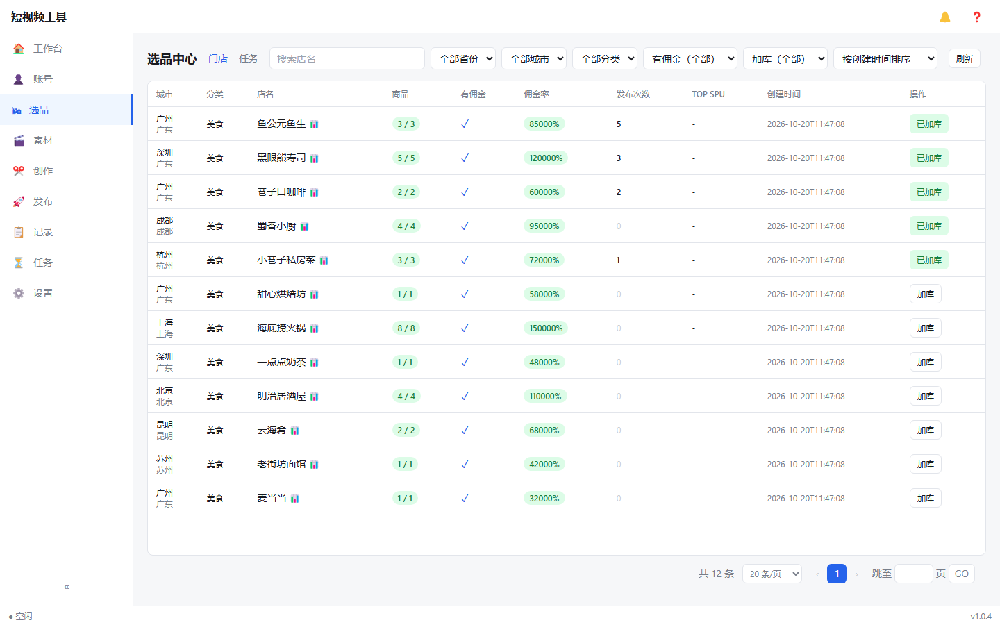

---

## 七、素材库

### 7.1 树形分类

左侧树形分类（无限层级）。右键新建 / 重命名 / 删除。

### 7.2 视频拉取

支持 4 种来源：

| 类型 | 说明 |
|---|---|
| **正则拉取** | 按正则匹配标题 / 话题 |
| **话题拉取** | 按话题标签 |
| **位置拉取** | 按地理位置 |
| **横竖屏** | 过滤横屏 / 竖屏 |

### 7.3 本地上传

拖拽文件到素材页 / 点击「**上传**」→ 选择文件 → 自动按 md5 去重 → 入库。

### 7.4 分享链接解析

粘贴目标平台分享链接 → 自动解析视频/图集 → 入库。

### 7.5 预览弹窗（可连续操作）

点素材卡片进入预览。弹窗顶部工具栏支持：

- **改分类**：把当前素材挪到其他分类
- **删除**：删掉当前素材
- **上一个 / 下一个**：在素材列表里翻看

> 💡 **关键**：改分类或删除后，**弹窗不会关闭**，会自动跳到列表中的下一个素材。你可以一口气看完整个分类，不用反复开关弹窗。

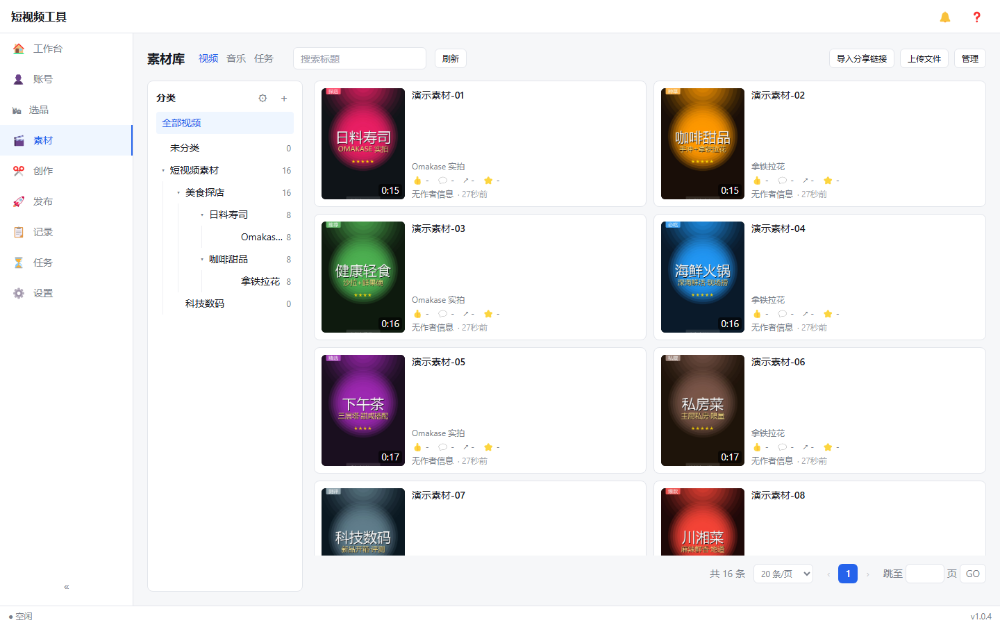

---

## 八、创作中心

### 8.1 项目 + 分镜

- **项目**：一个完整视频的主题（含若干分镜）
- **分镜**：单个镜头（视频片段 + 文案 + BGM 标记）

### 8.2 批量切割分配

支持「**固定时长**」或「**去头尾**」两种切割策略。切割后自动分配到分镜。

### 8.3 组合生成

- **组合键**：素材 + 排序方式 → 唯一防重复
- **BGM**：可选配 BGM 自动合成
- **去重处理**：抽帧 / 水印 / 干扰三种

### 8.4 项目门店绑定

在项目页右上「**绑定门店**」→ 选择已标记的门店 → 发布时自动挂载。

### 8.5 成品视频

组合生成后落入 `finished\<project_id>\`，可在创作页「**可用成品**」查看 / 删除 / 重导出。

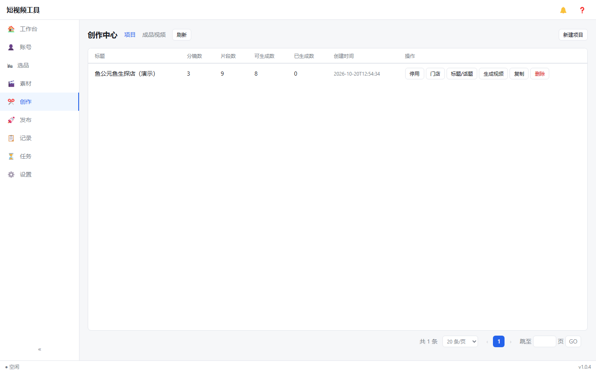

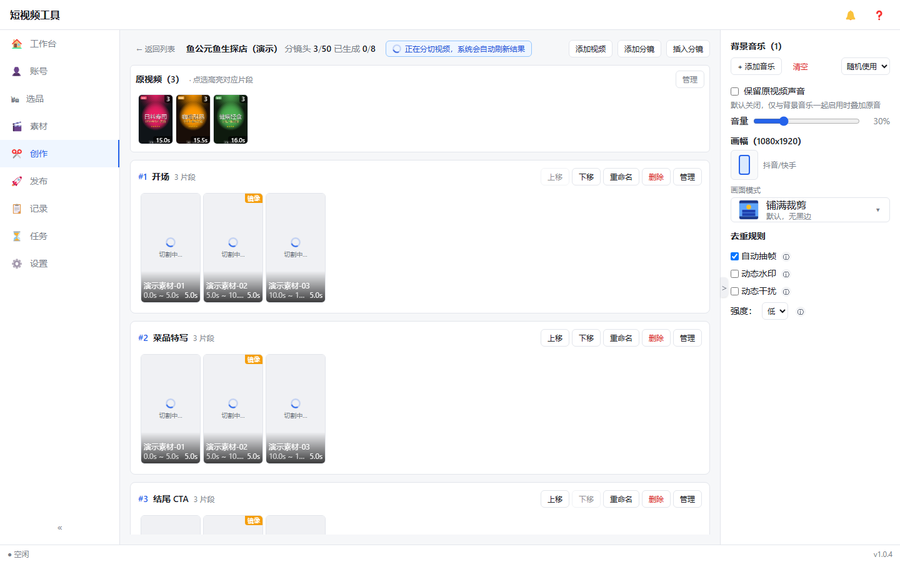

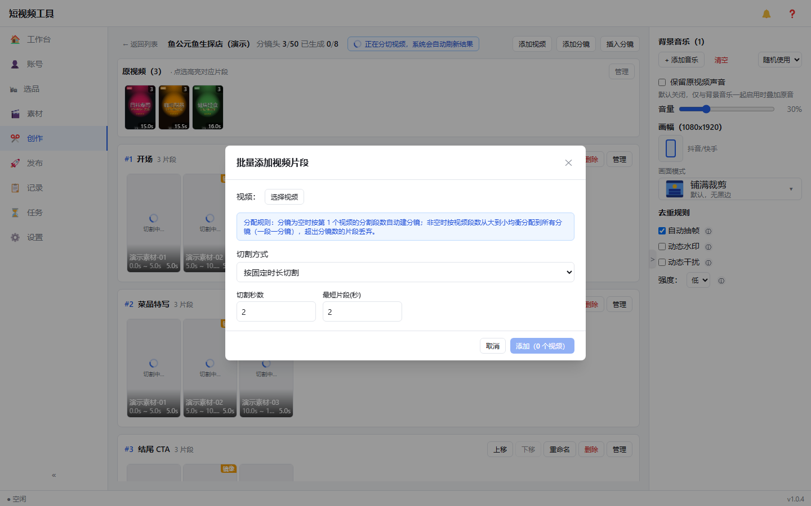

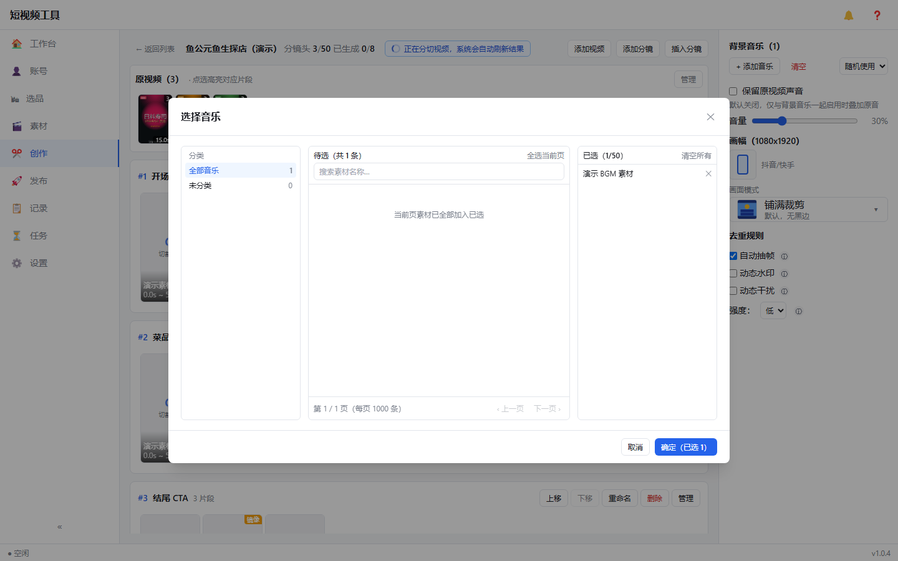

---

## 九、发布中心（核心）

### 9.1 6 步向导

| 步 | 标题 | 内容 |
|---|---|---|
| 1 | 选择账号 | 任务名 + 选择账号（多选） |
| 2 | 选择项目 | 选择项目（项目模式）或成品视频目录（视频目录模式） |
| 3 | 挂载门店 | 项目模式自动回查；视频目录模式手填 |
| 4 | 视频简介 | 按项目分组 + 话题编辑，支持全选 / 反选 |
| 5 | 排期规则 | 发布模式 + 时间窗 + 自主声明 + 允许下载 |
| 6 | 预览确认 | 排期明细 + 校验结果 + 确认创建并启动 |

> 💡 顶部进度条上**已完成的步骤可以点击回跳**，改完前面的配置后点回来看结果，不用从头再走一遍。

**6 步向导 6 张预览**：

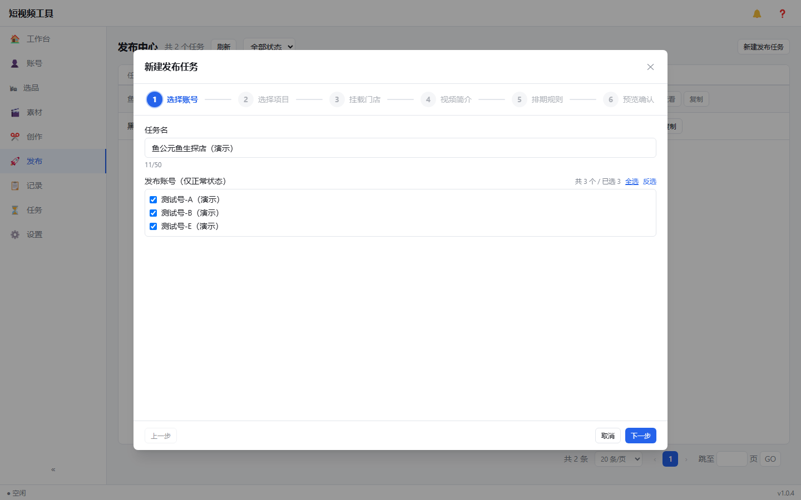

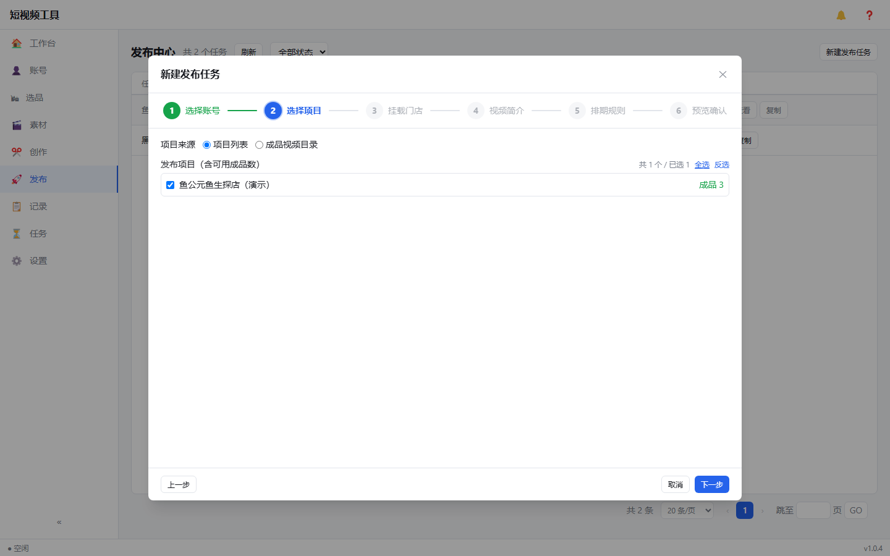

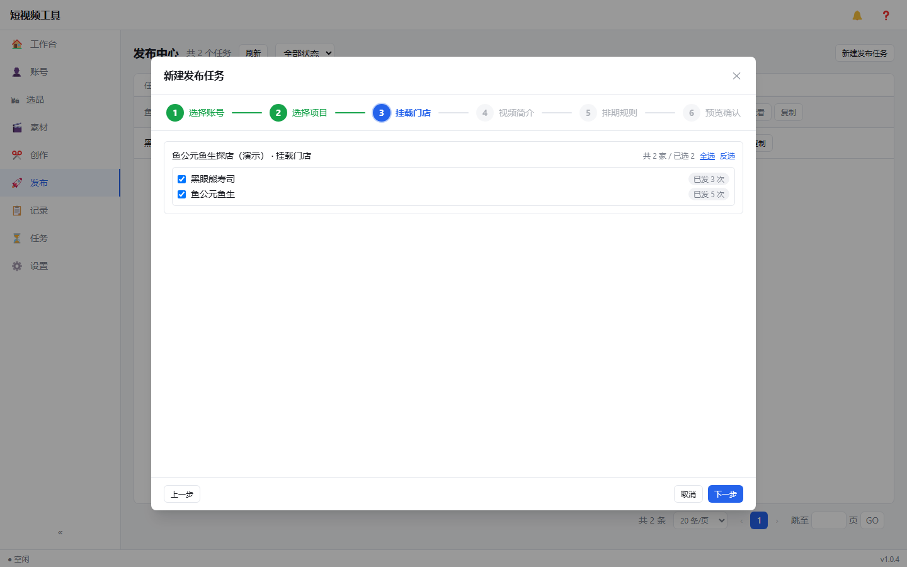

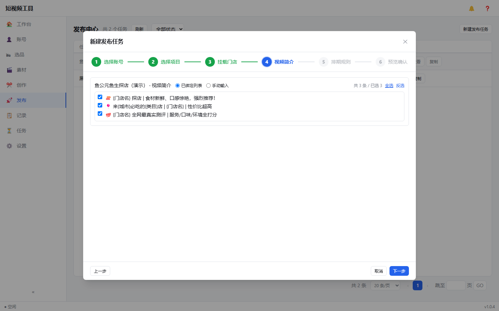

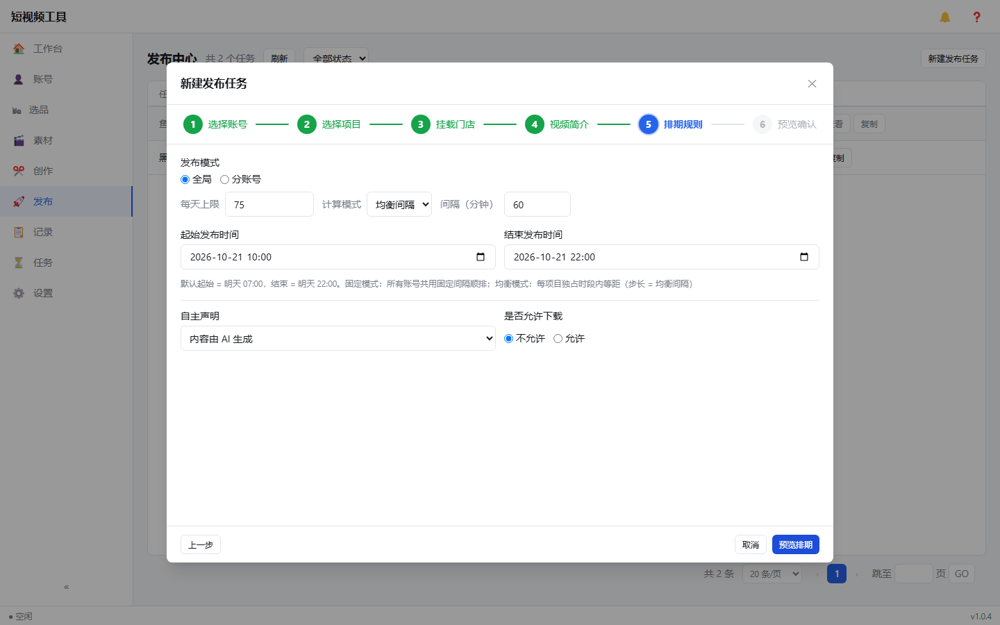

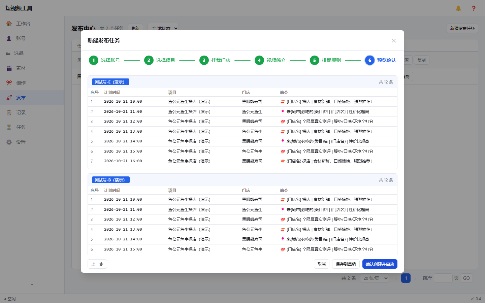

### 9.2 第 5 步详解 — 发布模式

「发布模式」分两种粒度：

**全局**：所有账号共用一套发布节奏。

**分账号**：每个账号单独设置一行（账号 / 每天上限 / 计算模式 / 间隔）。

| 计算模式 | 含义 |
|---|---|
| **固定间隔** | 每条视频之间间隔固定 N 分钟 |
| **均衡间隔** | 把所有视频**均匀铺满**在时间窗内 |

- **每天上限**：1–75 条，超出会自动回落到 75 并提示。
- 切换计算模式不会丢失你填的间隔值，两个模式的值分别保留。

**时间窗**：起始与结束时间都用**原生时间选择器**（不是手打），并且：

- 起始时间**不能选过去**（早于当前时间的选项会被拦截）
- 结束时间必须**晚于起始时间**
- 两处都做了前端拦截，保存时后端还会再校验一次

**自主声明 / 允许下载**：视频是否标记为 AI 生成、是否允许观众下载。

### 9.3 三段流（draft / preview / confirm）

- **draft**：保存草稿（不启动），可随时打开继续编辑
- **preview**：预览排期表 + 校验（避免视频不足 / 时间冲突）
- **confirm**：确认创建 + 启动任务

> 💡 第 6 步预览页如果提示「门店配置与数据库不一致」，点横幅上的「**回到第 3 步重选门店**」直接跳回去改。

### 9.4 复制 / 编辑任务

- 任务列表里可以**复制**或**编辑**已有任务配置。
- 复制 / 编辑时，**原任务里已经失效的门店会被自动剔除**，不会把脏数据带进新任务。
- 复制任务时，起始时间默认顺延到**明天**，不会跟原任务撞车。
- 视频简介**允许留空**，不会因为没填简介就卡住流程。

### 9.5 任务状态

发布页任务列表会展示每个任务的：

- 进度（已完成 / 总数）
- 当前正在发布的视频
- 失败原因（如有）

> 💡 **失败重试**：单个视频失败不会终止整个任务，可在「**发布记录**」点单条「**重试**」。

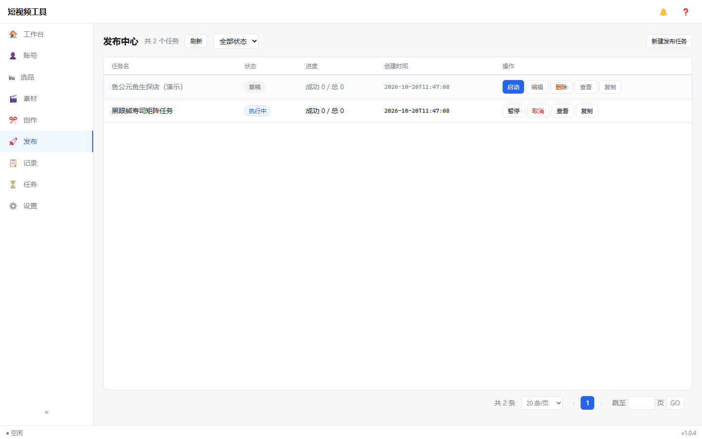

### 9.6 发布记录

全字段留痕（账号 / 门店 / 视频路径 / 简介快照 / 话题快照 / 自主声明 / 是否允许下载 / 时间戳）。支持 Excel 导出。

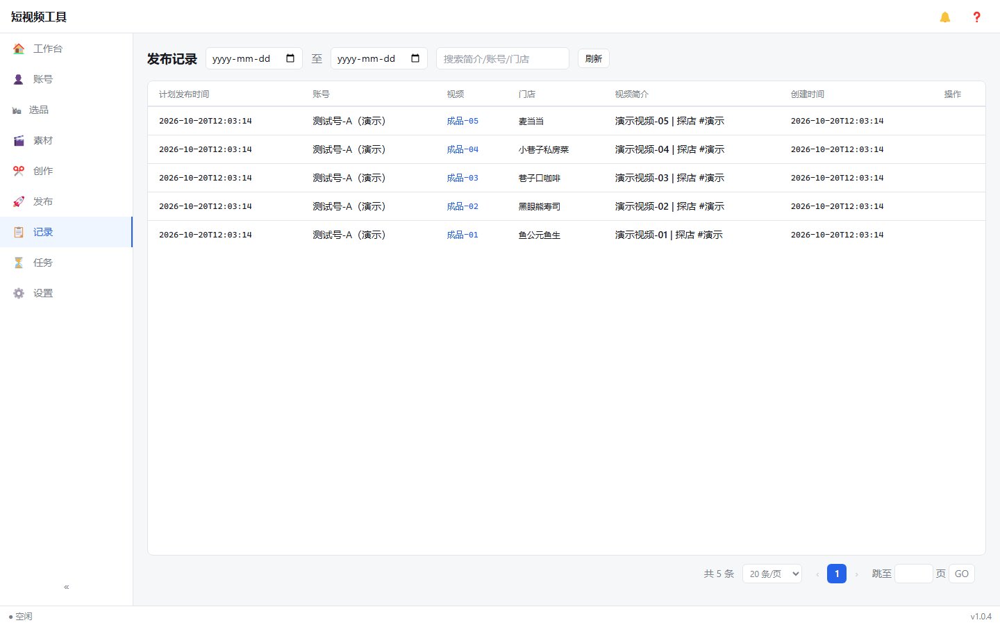

---

## 十、系统设置

顶部 5 个 Tab：

### 10.1 通用

- **日志保留天数**（默认 30，范围 7-90）：超过自动删除 `log/` 下日志
- **缓存清理阈值（天）**（默认 7，范围 1-90）：启动期清理 `temp/` 旧文件

### 10.2 任务队列

查看所有后台任务（运行中 / 已完成 / 失败）。可手动「**取消**」卡住的任务。

### 10.3 数据目录

- **数据目录路径**（只读展示）+「**更改**」按钮
- **健康检查**：一键检测数据目录空间 / 写入权限 / 数据库完整性
- **清理 temp 与 cache**：手动清理（不影响素材 / 成品 / 数据库）
- **人脸检测命中帧证据目录**：人脸误判 / 漏判复盘用

> ⚠️ **更改数据目录后必须重启**才会生效。

### 10.4 备份恢复

- **立即备份**：打包整个数据目录到 zip（含 db + accounts + material + finished + log）
- **从备份恢复**：选择 zip → 自动校验 → 解压到当前数据目录（覆盖前会确认）

> 💡 **建议**：每次大批量发布前手动备份一次。

### 10.5 通知中心

聚合所有系统通知（账号失效 / 发布失败 / 系统错误 / 清理提示）。可一键「**全部已读**」。

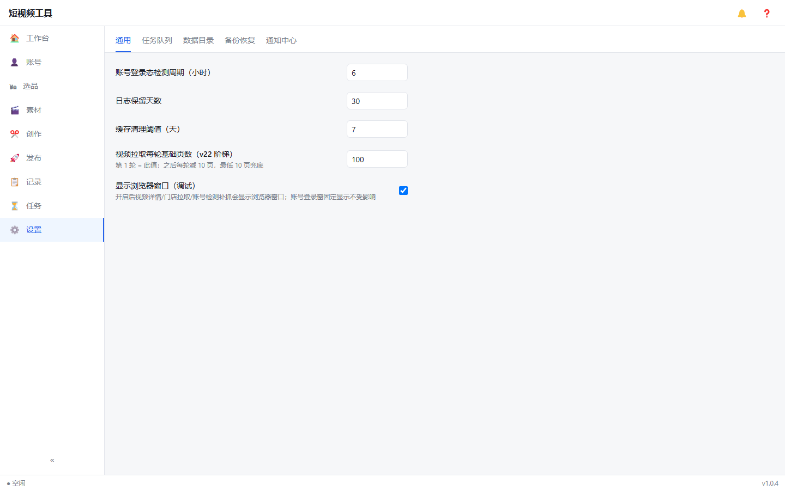

---

## 十一、自动更新（1.0.4 新增）

程序会**自动**检查并下载新版本，你不需要手动去下载安装包。

**运作方式**：

1. 每次打开程序，后台自动检查一次有没有新版本（静默，不打扰）。
2. 发现新版本后自动开始下载，**不需要你确认**。
3. 下载中：版本号旁边显示转圈。
4. 下载完成：显示红色「**有更新**」徽标。

**怎么装**：

- **最省事**：什么都不做，正常退出程序时会自动安装，下次打开就是新版。
- **立刻装**：点红色「**有更新**」徽标 → 立即重启并安装。

**手动触发检查**：底部状态栏或「关于系统」弹窗里的**版本号本身就是个按钮**，点一下就能重新检查一次。

> 💡 自动更新只在**打包安装版**生效；开发调试版不联网检查更新。

---

## 十二、数据备份与恢复

### 12.1 备份策略

| 场景 | 建议 |
|---|---|
| 大批量发布前 | 手动备份 |
| 每周 / 每月 | 手动备份（自动备份未内置） |
| 迁移数据目录 | 备份 + 恢复（而不是手动复制） |

### 12.2 备份位置

- **手动备份**：保存路径由你选（默认建议非系统盘）
- **备份内容**：完整数据目录 zip（含全部业务数据 + 登录态）

### 12.3 恢复流程

1. 设置 → 备份恢复 →「**从备份恢复**」
2. 选择 zip 文件
3. 系统自动校验完整性
4. 确认覆盖 → 重启后生效

> ⚠️ **恢复会覆盖当前数据**：恢复前会自动备份当前数据到 `backup-before-restore-<时间戳>.zip` 兜底。

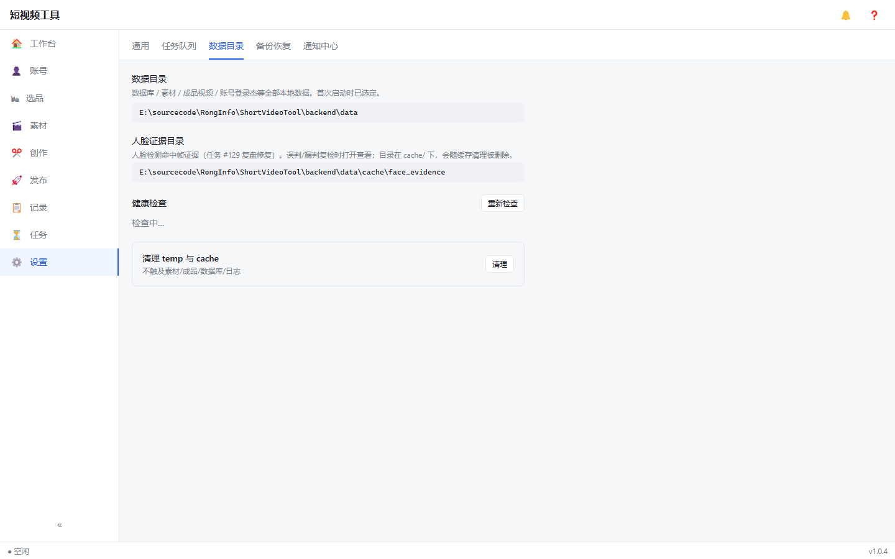

---

## 十三、常见问题

### Q1：启动时弹「后端服务无法启动」错误框

**原因**：通常是 ffmpeg 缺失或不含 libx264 编码器。

**处理**：
1. 看错误框的「详细信息已写入日志」路径（`%APPDATA%\com.rong-info.shortvideotool\logs\backend-startup-error-YYYY-MM-DD.log`）
2. 确认 `backend\assets\ffmpeg\ffmpeg.exe` 存在
3. 运行 `ffmpeg.exe -encoders | grep libx264` 确认有 libx264
4. 如缺失，重新安装带 libx264 的 FFmpeg
5. 修复后重启程序

**首次启动较慢**：首次启动会跑 ffmpeg 环境检查（10-20s）+ 数据迁移，**30s 内健康检查不通会误报**。点「**再等一会**」再等 30s 通常即可。

### Q2：改了「数据目录」后 SettingsPage 还显示旧路径

**原因**：更改数据目录必须**重启程序**才生效（旧的 Chromium profile / 数据库连接仍指向旧目录）。

**处理**：
1. 设置 → 数据目录 →「**更改**」→ 选新目录
2. 系统会提示「更改后需重启生效」
3. 点「**立即重启**」→ 程序自动结束所有后端进程 + 重启

> ⚠️ 重启前如果还有发布任务在跑，会被强制中断。建议先等当前任务完成。

### Q3：第二次打包安装后启动报「后端无法启动」

**原因**：NSIS 覆盖安装只关主 exe `ShortVideoTool.exe`，**不会自动结束之前拉起的后端进程** `shortvideo-backend.exe`，旧实例仍占着 8765 端口。

**处理**：本工具已内置自动清理：
- 启动时会检测端口占用情况，必要时主动杀掉旧实例再拉起新后端
- 启动后还会二次验证后端是否真的可用，不通会自动重启一次
- 退出时会强制结束整棵进程树（含 ffmpeg 子进程）

如仍异常：
1. 打开任务管理器 → 结束所有 `shortvideo-backend.exe` 和 `python.exe`（uvicorn）
2. 重新启动程序

### Q4：账号显示「失效」但浏览器里看是正常的

**原因**：通常是 Cookie 过期（不只是登录态过期）。

**处理**：
1. 在正常浏览器打开目标平台 → 确认登录态
2. DevTools → Application → Cookies → 复制完整 Cookie 字符串
3. 工作台 →「**重新登录**」→ 选「**粘贴 Cookie**」→ 完成

### Q5：发布任务一直卡在「排队中」

**可能原因**：
- 数据目录写满（素材 / 成品过多）→ 清理 temp / finished 历史文件
- 数据库损坏 → 设置 → 数据目录 →「**健康检查**」→ 异常按提示修复
- ffmpeg 不可用 → 同 Q1

### Q6：日志在哪？

| 类型 | 路径 |
|---|---|
| 主进程日志 | `%APPDATA%\com.rong-info.shortvideotool\logs\main-YYYY-MM-DD.log` |
| 后端启动错误 | `%APPDATA%\com.rong-info.shortvideotool\logs\backend-startup-error-YYYY-MM-DD.log` |
| 后端业务日志 | `<数据目录>\log\app_YYYYMMDD.log` |

反馈问题请附「主进程日志」+「后端启动错误日志」+ 触发步骤。

### Q7：能否多个账号同时跑？

**支持**，但**不推荐**。每个账号的发布任务会串行执行（避免触发平台风控），多账号并发会导致总时长翻倍且容易被识别为脚本。建议账号 ≤ 5 个，每个账号按节奏发布。

### Q8：怎么确认我装的是不是最新版本？

1. 看「设置 → 关于系统」或底部状态栏的版本号。
2. **点击版本号**可手动触发一次检查。
3. 有新版会显示红色「有更新」徽标，点它即可立即安装。

---

## 十四、风险提示与免责声明

1. **本工具依赖目标视频平台 Web 接口（非官方开放能力）**，平台规则可能随时变化，影响自动化行为。
2. **过度使用可能影响账号权重**，甚至导致账号被封。首次启动已弹出风险告知。
3. **使用频率请自行把控**：建议每个账号每天发布 ≤ 5 条，账号之间错开时间。
4. **本工具不存储账号密码**，只存 Cookie / Chromium profile。Cookie 泄露风险等同账号泄露，请妥善保管本地数据目录。
5. **定期备份**：本工具不提供云端备份，请按「十二、数据备份与恢复」节策略自行备份。
6. **本程序基于 GNU AGPL-3.0 开源**：源码仅供学习研究使用，以「按原样」原则提供；基于本程序修改并通过网络对外提供服务时，须同样以 AGPL-3.0 开源修改后的完整源码。使用即视为同意上述声明。

---

## 附录 A：快捷键

| 快捷键 | 功能 |
|---|---|
| Ctrl + F12 | 打开 / 关闭开发者工具 |
| Esc | 关闭弹窗 / 抽屉 |
| 方向键 ↑↓ | 列表上下选 |
| Enter | 确认操作 |

## 附录 B：术语表

| 术语 | 含义 |
|---|---|
| **项目** | 一个完整视频的主题（含若干分镜） |
| **分镜** | 单个镜头（视频片段 + 文案 + BGM 标记） |
| **组合生成** | 把分镜素材按规则拼接成完整视频 |
| **抽帧 / 去重** | 通过删除首尾 / 中间帧降低重复率 |
| **草稿 (draft)** | 未启动的发布任务，可继续编辑 |
| **预览 (preview)** | 排期表 + 校验，不启动 |
| **确认 (confirm)** | 创建任务并启动执行 |
| **固定间隔** | 每条视频间隔固定 N 分钟发布 |
| **均衡间隔** | 把视频均匀铺满在设定的时间窗内 |
| **Cookie** | 浏览器登录态凭证，存于 `accounts\<id>\profile\` |
| **累计发布次数** | 该门店发布成功的总次数，用于轮换参考 |

## 附录 C：联系反馈

如遇程序 bug / 使用问题，请附以下信息：

1. 程序版本（点顶部 ❓ → 关于系统）
2. 触发步骤（含截图）
3. 主进程日志 + 后端启动错误日志
4. 数据目录健康检查结果（设置 → 数据目录 → 健康检查）